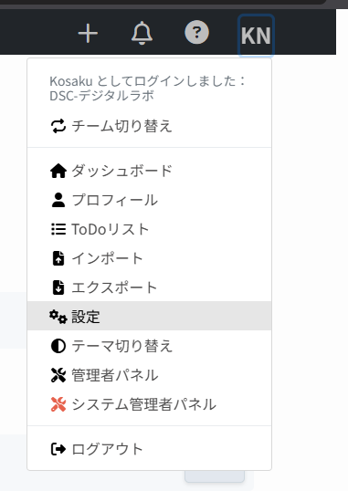
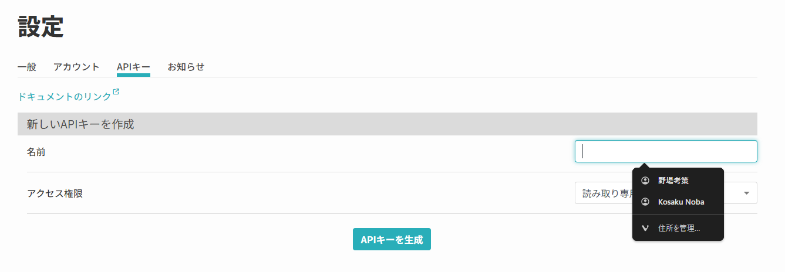
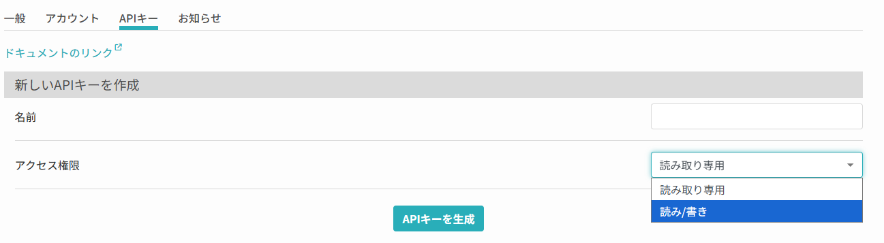
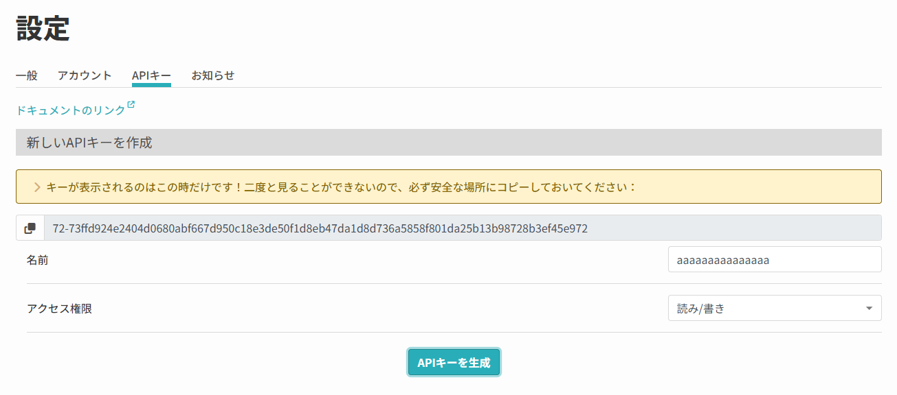

# elab-doc-sync

Markdown ドキュメントを eLabFTW に同期する CLI ツール。`esync` エイリアスでも使えます。

## これは何？

ローカルの Markdown ファイルを eLabFTW のリソースや実験ノートとして管理するツールです。普段使い慣れたエディタで書いて、コマンド一発で eLabFTW に反映できます。eLabFTW 側で編集された内容の取り込み（両側の変更のマージを含む）、画像・添付ファイル・文書間リンクの変換、タグ・カテゴリ・リンクの設定にも対応しています。

## 最近の主な変更

| バージョン | 内容 |
|---|---|
| v1.0 | 安全な pull、バックアップ・復元、紐付けを保持する `mv`、途中失敗からの再開。同期モードは `each` のみ |
| v1.0.1 | `esync rm` でディレクトリ・glob・正規表現を指定 |
| v1.0.2〜v1.0.3 | 差し替えた画像の古い版の削除、別ターゲットの文書へのリンク変換 |
| v1.0.4 | pull で両側の変更を 3-way マージ、前回の同期からの変更を表示する `diff`、文書を指定した `push`、状態ごとの次の操作の案内 |
| v1.0.5 | pull した Markdown の `&gt;` などを戻す、eLabFTW が削除した `<…>` を警告 |
| v1.1.0〜v1.1.2 | 実験ノート・リソースどうしのリンク（`esync relate`、ターゲット設定 `links`）、リンク元・リンク先をパスで指定 |

v0.x からの更新は、先に [v1.0への移行と復旧](docs/13_MIGRATION_V1.md) を確認してください。変更履歴は [Changelog](CHANGELOG.md)、検証環境・結果は [リリース検証](docs/14_RELEASE_VALIDATION.md)、詳しい仕様は [docs/](docs/01_README.md) にあります。

---

## まず使えるようにする（初回セットアップ）

### 必要なもの

- Python 3.10 以上
- [uv](https://docs.astral.sh/uv/)

### インストール

```bash
uv tool install --force git+https://github.com/Kosaku-Noba/elab-doc-sync.git
```

### 初期設定（質問に答える）

```bash
esync init
```

```
=== elab-doc-sync セットアップ ===

eLabFTW の URL: https://<eLabFTWへのURL>/
SSL 証明書を検証しますか？ [Y/n]: n
Markdown ファイルを置くディレクトリ（空欄で docs/）:<好きな場所>
同期する Markdown のファイルパターン（空欄で *.md）:
送信先 — items(resources): リソース / experiments: 実験ノート [items]:
送信形式 — md: Markdown のまま / html: HTML に変換 [md]:

```

URL、保存先、送信先を聞かれるので順に答えると `.elab-sync.yaml` が生成されます。

### API キーを設定する

eLabFTW → ユーザー設定 → API Keys でキーを作成し、`.elab-sync.yaml` に貼る:

#### APIキーの設定場所(elabFTW側)



左上ボタンから設定をクリック



設定内のAPIキーから名前を入力



アクセス権限を読み書きに変更



でてきた文字列をコピー(このときしか出ないので注意)

```yaml
elabftw:
  url: "https://your-elabftw.example.com"
  api_key: "ここにキーを貼る"
  verify_ssl: false
```

あるいは環境変数でもOK（設定ファイルより優先されます）:

```bash
export ELABFTW_API_KEY="your_key"
```

接続できるかは `esync whoami` で確認できます。ユーザー名と現在のチームが表示されれば準備完了です。

### Git管理から除外する

`esync init` が作る `.gitignore` には次が含まれます。既に `.gitignore` がある場合は追記されないので、手動で追加してください。APIキーや退避した本文の公開を防ぎ、同期・復旧記録を手元に保持します。

```gitignore
.elab-sync.yaml
.elab-sync-ids/
.elab-sync-backups/
.elab-sync-operations/
.elab-sync-recovery.json
```

独自の `id_file` を設定した場合は、専用の親ディレクトリ全体も除外してください。例えば `id_file: .sync-state/team/default.id` なら `.sync-state/team/` を `.gitignore` に追加します。同じ場所に紐付けやリモート本文を含む状態記録も保存するため、IDファイル単体の除外では不十分です。これらの記録は復旧に必要なので、一括削除しないでください。

---

## 日常の使い方

### 書いたものを eLabFTW に送る（push）

```bash
esync
```

変更があるファイルだけ自動で送信されます。変更がなければスキップ:

```bash
$ esync
  [実験メモ] 変更なし（スキップ）
```

### 送信前に確認だけしたい

```bash
esync --dry-run
```

### 今の状態を確認する（status）

```bash
esync status
```

文書ごとに「最新」「送信待ち」「取得待ち」「競合」などの状態を表示し、続けて次に実行できるコマンドを `→` で案内します。

```text
  [a.md] 競合（#42）
    → 両方の変更をマージ: esync pull（同じ箇所の変更はマーカーで残る）
    → ローカルを採用（eLabFTW を上書き）: esync push --force docs/a.md
    → eLabFTW を採用（ローカルを上書き）: esync pull --id 42 --entity items --force
```

状態ごとの対処は [競合を確認・復旧する](#競合を確認復旧する) を参照してください。

### ローカルと eLabFTW の差分を見る（diff）

```bash
esync diff                 # 全文書
esync diff docs/note.md    # 指定した文書だけ（push と同じ指定方法）
```

文書ごとに、前回の同期からの変更を次の 2 つに分けて表示します。

- **ローカルの変更**: 前回同期した時点から、手元で編集した箇所
- **eLabFTW 側の変更**: 前回同期した時点から、eLabFTW で変わった本文・タイトル・カテゴリ・タグ・添付

前回の同期時点と比べるため、eLabFTW が保存時に本文を書き換えた分（箇条書きの記号など）や画像パスの違いは差分に出ません。

### eLabFTW から最新を取得する（pull）

既に同期済みのファイルを再取得:

```bash
esync pull
```

ローカルを編集していない文書は eLabFTW の内容で更新し、ローカルだけを編集した文書はそのまま残します。両側が編集した文書はマージします（[競合を確認・復旧する](#競合を確認復旧する)）。

eLabFTW 上の特定の記事をローカルに持ってくる:

```bash
esync pull --id 42 --entity items
```

- `--id` は eLabFTW の記事番号です（URL の末尾やタイトル横に表示される `#42` のような数字）
- `--entity` は記事の種類です:
  - `items`（= リソース）: 試薬、プロトコル、機器情報など
  - `experiments`（= 実験ノート）: 実験記録

複数まとめて取得:

```bash
esync pull --id 42 --id 43 --id 44 --entity items
```

pull 時、ローカルのどのディレクトリに保存するかは **タグ・カテゴリ・タイトル** から自動判定されます（[pull の自動振り分け](#pull-の自動振り分け)）。判定できない場合は対話で聞かれます。

### 一部の文書だけ push する

```bash
esync push docs/note.md            # 1 文書だけ
esync push docs/subdir             # 配下の文書を再帰的に選択
esync push 'docs/note*.md'         # glob
esync push --regex '^2026-'        # ファイル名に正規表現で一致
```

未追跡の文書は新規作成します。指定しなかった文書は送信しないため、変更は次回の push まで残ります。詳細は [CLI リファレンスの push](docs/05_CLI_REFERENCE.md#pushデフォルトコマンド) を参照してください。

### ファイル名を変える

```bash
esync mv docs/旧タイトル.md docs/新タイトル.md
esync push
```

紐付けを保持して移動し、次のpushでタイトルを更新します。自動検出は本文ハッシュが一致し、対応が一意な場合だけ行います。本文編集も伴う移動は `esync mv` を使ってください。

### 文書の追跡解除

```bash
esync rm docs/note.md                  # 文書を保持して同期対象から除外
esync rm 'docs/old*' --dry-run         # glob で選び、対象を事前に確認
esync rm docs/note.md --local          # ローカル Markdown も削除
esync rm --id 42 --entity items        # リモート ID で指定
```

リモートのデータは保持します。解除したファイルは今後の push・status の対象から除外されます。ディレクトリ・正規表現での指定や再登録方法は [CLI リファレンス](docs/05_CLI_REFERENCE.md#rm--追跡解除) を参照してください。

### 競合を確認・復旧する

```bash
esync status
esync diff
esync pull --dry-run
esync backup list
esync restore <バックアップID> --dry-run
esync restore <バックアップID>
```

通常のpullはローカル未編集の文書を更新し、ローカルだけの変更は保持します。上書き・削除・移動前にバックアップを保存し、復元直前の状態も退避します。

両側が本文を変更した文書（状態「競合」）は、pull で git と同じようにマージします。

- 前回の同期時点の本文を基準に、片側だけが変えた箇所はそのまま取り込みます
- 両側が同じ箇所を別々に変えた場合は、その箇所を両方残してマーカーで囲みます

```text
<<<<<<< ローカル
ローカルの内容
=======
eLabFTW の内容
>>>>>>> eLabFTW #42
```

- マーカーが残った文書があると pull は終了コード 1 を返し、文書の一覧を表示します。マーカーを消して内容を整えてから push してください。マーカーが残っている間、その文書の push と通常の pull は止まり、`status` は「競合マーカーあり」を表示します。`push --force` でも送信しません。`pull --force` はマーカーごとローカルを eLabFTW の内容で上書きします（変更前の文書はバックアップされます）
- マージ結果は eLabFTW にはまだ送っていないため、状態は「送信待ち」になります。push で送信してください
- 判定に使うのは esync が付けるマーカー（`<<<<<<< ローカル` と `>>>>>>> eLabFTW`）だけです。文書中の git のマーカー例や、見出しの下線の `=======` は競合と扱いません
- v1.0.4 より前に同期した文書は基準の本文が保存されていないため、両側の差がある箇所をすべてマーカーで示します。次に同期した時点から基準を保存します
- マージ時、既にあるローカルの画像・添付ファイルは上書きしません。eLabFTW 側で同じ名前のまま差し替えた画像・添付は取り込まれないため、必要なら `pull --force` で取得してください
- マージせずにどちらかを採用する場合は、`pull --force` または `push --force` を使います

**復元はバックアップに記録されたディレクトリまたはファイル全体に適用されます。** 保存後に追加したファイルも復元先から取り除かれるため、必ず `restore --dry-run` で範囲を確認してください。バックアップは自動削除されません。不要な世代は復旧不要と確認してから手動で削除できます。

`pull --force` はローカルを退避して上書きします。`push --force` はリモート本文を退避して上書きします。リモート本文の退避データは復元時にJSONへ取り出し、確認後に手動で反映します。

主な状態と対処は次のとおりです。

| 状態 | 対処 |
|---|---|
| 最新 | 操作不要 |
| 送信待ち | `push` でローカルの変更を送る |
| 取得待ち | `pull` でリモートの変更を取得する |
| 競合 | `pull` でマージする。マーカーが残ったら解消して `push`。マージせずに片側を採用する場合は `push --force` または `pull --force` |
| 競合マーカーあり | 文書のマーカーを解消してから `push` |
| 基準情報なし | `diff` で確認し、採用する側を決めてから `push --force` または `pull --force` |
| リモート削除 | eLabFTW で記事が削除された。強制pushでも再作成しない。追跡をやめるなら `rm <ファイル>`、作り直すなら `rm <ファイル>` → `link --new --file <ファイル名>` → `push <ファイル>` |
| 同期未完了 | 前回の push が途中で止まった。`push` で再開する。eLabFTW 側が変わって再開できない場合は、`push --force <ファイル>`（ローカルを採用）または `pull --id <ID> --entity <種別> --force`（eLabFTW を採用） |
| 確認失敗 | 接続・APIキーを確認して再実行する |

新規作成の応答が失われた場合は、重複作成を避けるため停止します。サーバー上の記事を確認し、存在すれば `link`、存在しないと確認できた場合だけ `link --new --file <ファイル名>` で再開します。

移行・復元範囲・途中失敗の扱いは [v1.0への移行と復旧](docs/13_MIGRATION_V1.md) を参照してください。

---

## 応用: こういう場面ではこうする

### eLabFTW にある既存プロジェクトをローカルに持ってきたい

```bash
export ELABFTW_API_KEY="your_key"
esync clone --url https://elab.example.com --entity items --id 42 --id 43
```

`elab-clone-42/` にプロジェクトディレクトリ一式（`.elab-sync.yaml`・`.gitignore`・取得した文書）が生成されます。`--dir` で名前を変えられます。

### 別の PC や共同編集者と同じ文書を扱いたい

同期状態（`.elab-sync-ids/`）は PC ごとに持ち、Git では共有しません。別の PC で同じ記事を扱うときは、その PC で記事と文書を紐付けてから使います。紐付けずに push すると、eLabFTW に別の記事として新規作成されます。

**文書を Git で共有していない場合**: eLabFTW から取得します。

```bash
esync pull --id 42 --id 43 --entity items
```

**文書を Git で共有している場合**: 既にある文書を記事に紐付けます。

```bash
esync list                                        # 記事の ID を確認
esync link 42 --file note.md --target docs        # --file は docs_dir からの相対パス
esync diff docs/note.md                           # 紐付けた時点の eLabFTW の本文との差を確認
```

**紐付けた直後の差は pull ではマージされません。** `link` は紐付けた時点の eLabFTW の本文を同期の基準にするため、手元の文書との差はすべて「ローカルの変更」（送信待ち）として扱われます。手元の文書が古いまま push すると、eLabFTW 側にしかない追記が消えます。紐付けたら `esync diff` で差を確認し、次のどちらかにしてください。

- eLabFTW の内容を採用する: `esync pull --id 42 --entity items --force`（手元の文書はバックアップされる）
- 両方の内容が必要: 手元の文書を手で統合してから `esync push`

差がなければ（`diff` に「ローカルの変更」が出なければ）そのまま使えます。紐付けの前に `git pull` で文書を最新にしておくと、差を小さくできます。

紐付けた後は、普段どおり作業の前に `esync pull`、後に `esync push` します。eLabFTW の画面で誰かが編集していても、pull で両側の変更をマージできます（同じ箇所の変更はマーカーで残ります）。

### 週報と実験メモを別ディレクトリで管理したい

`.elab-sync.yaml` でターゲットを分ける:

```yaml
targets:
  - title: "週報"
    docs_dir: "weekly_reports/"
    entity: items
    tags: ['週報']
    title_pattern: "*週報*"    # pull 時のタイトル自動振り分け

  - title: "実験メモ"
    docs_dir: "experiments/"
    entity: experiments
```

push 時は各 `docs_dir` から送信され、pull 時はタグやタイトルから適切なディレクトリに自動配置されます。`esync -t 週報` のように `title`（または `docs_dir`）で 1 つのターゲットだけを対象にできます。

### 別チームの eLabFTW にも投稿したい（複数 API キー）

eLabFTW の API キーはチームごとに発行します。プロファイルにキーとチームを登録し、ターゲットで `team`（または `profile`）を指定します。

```yaml
profiles:
  TeamA:
    url: "https://elab.example.com"
    api_key: "59-xxxx..."
    team: "TeamA"
  TeamB:
    url: "https://elab.example.com"
    api_key: "60-yyyy..."
    team: "TeamB"

targets:
  - docs_dir: "docs/"
    team: "TeamA"          # 同じ team のプロファイルのキーで送信
  - docs_dir: "TeamA_docs/"
    team: "TeamB"
  - docs_dir: "TeamB_docs/"
    profile: TeamB          # プロファイル名で直接指定することもできる
    tags: ['共同研究']
```

プロファイルはコマンドでも追加できます。各キーのチームは `esync whoami` で確認できます。

```bash
esync profile add team-b --url https://elab.example.com --api-key "team-b-key"
esync profile list
esync whoami
```

push・pull・`tag`・`relate`・`metadata`・`entity-status`・`verify` は、ターゲットごとにその接続先で送信します。`category`・`list`・`new` は `-t` で選んだターゲットの接続先を使います。

### eLabFTW のテンプレートから実験ノートを書き始めたい

```bash
esync new --list                                  # 実験テンプレートの一覧
esync new --template-id 3 --title "2026-10-21 培養" -t 実験メモ
esync push
```

テンプレートの本文を Markdown に変換し、`-t` のターゲット（省略時は最初のターゲット）の `docs_dir` に保存します。`-o` で保存先を指定できます。

### タグやカテゴリを操作したい

```bash
esync tag list                                      # 同期済みの全文書のタグ
esync tag add "重要"                                # 同期済みの全文書に追加
esync tag add "new-tag" --id 42 --entity items      # 記事を指定
esync category list --entity items
esync category set "試薬" --id 42 --entity items
```

`--id` を省略すると、各ターゲットの同期済み文書に、そのターゲットの接続プロファイルで送信します。`--id` を指定した場合、接続先は `-t` で選んだターゲットのプロファイルです（`-t` を省略すると default、一致するターゲットがなければ何も送信せずエラー）。

```bash
# 上の例の shared_docs/ 側の記事 #42 にタグを追加
esync tag -t shared_docs add "new-tag" --id 42 --entity items
```

push のたびに付けたいタグ・カテゴリは、ターゲットの `tags`・`category` に書きます。push はタグを追加するだけで外さないため、外すときは `esync tag remove` を使います。

### ステータスやメタデータをまとめて変更したい

```bash
esync entity-status -t 実験メモ show                 # 各文書の現在のステータス
esync entity-status -t 実験メモ set 2                # 全文書を変更（確認あり）
esync metadata -t 実験メモ set project=A phase=2     # メタデータ（JSON）に追記
```

`-t` は `show`・`set` などより前に書きます。ステータスはチーム設定のステータス ID で指定します。`--id 42` で 1 件に絞れますが、`-t` を省略すると全ターゲットそれぞれの #42 が対象になるため、`-t` と組み合わせてください。

### 実験ノートやリソースどうしをリンクしたい

eLabFTW の「リンク」（実験ノート・リソースの関連付け）を張れます。

```bash
# リソース #42 から実験ノート #12, #15 にリンク
esync relate add 12 15 --to experiments --id 42 --entity items

# 同期済みの文書はパスで指定できる（リンク元は --from、種別は自動で決まる）
esync relate add "SPECIFICATION/仕様書.md" --from exp/2026-10-20.md

# リンク一覧・解除（リンク先の記事は消えません）
esync relate list --from exp/2026-10-20.md
esync relate remove 15 --to experiments --id 42 --entity items
```

`--from` の後ろはすべてリンク元になるため、リンク先は `--from` より前に書きます。`--from` も `--id` も省略すると、全ターゲット（`-t` 指定時はそのターゲット）の同期済みの全文書がリンク元になります。

同期する文書に決まったリンクを張りたい場合は、ターゲットに `links` を書きます。push 時に、そのターゲットの全文書から指定した記事へのリンクを追加します（追加のみで、既存のリンクは外しません）。

```yaml
targets:
  - docs_dir: "docs/"
    entity: experiments
    links:
      items: [42, 43]        # リソース（resources とも書ける）
      experiments: [12]      # 実験ノート
```

指定方法の詳細とエラーの条件は [CLI リファレンスの relate](docs/05_CLI_REFERENCE.md#relate--実験ノートリソース間のリンク)、`links` の挙動（記録・再試行・張り直し）は [設定ファイル仕様の links](docs/04_CONFIGURATION.md#links実験ノートリソースへのリンク) を参照してください。

### リモートに何があるか・何をしたか見たい

```bash
esync list                        # リソース一覧
esync list --entity experiments   # 実験ノート一覧
esync verify                      # 紐付けた記事にアクセスできるか確認
esync log                         # 最近の push・pull の履歴
```

### ファイルを既存のエンティティに手動で紐付けたい

```bash
esync link 42 --file "実験メモ.md"
```

`--file` は `docs_dir` からの相対パスです。ターゲットが複数ある場合は `--target` も指定します。

### PDF や CSV も一緒に送りたい（添付ファイル）

```yaml
targets:
  - docs_dir: "docs/"
    attachments_dir: "attachments/"
    entity: items
```

`attachments/` に置いたファイルが push 時に自動アップロードされます。本文から `[データ](data/result.csv)` のようにリンクしたファイルもアップロードされ、リンクが eLabFTW の URL に変わります。

本文から参照している画像・ファイルを同じ名前のまま差し替えると、push 時に新しい版をアップロードし、本文から参照されなくなった古い版の添付を削除します（`--prune-attachments` は不要）。`--prune-attachments` は、ローカルの `attachments/` にないリモート添付を削除する push のオプションです。削除した添付は esync のバックアップからは復元できません。

画像・動画・ファイルリンク・添付の送信対象は、プロジェクト内の通常ファイルに限定します。プロジェクト外への参照、隠しファイル・隠しディレクトリ、シンボリックリンクは拒否します。[送信制約と復旧](docs/13_MIGRATION_V1.md#バックアップと復元) も参照してください。

### 数式を使いたい

```yaml
targets:
  - docs_dir: "docs/"
    body_format: md    # ← Markdown のまま送信（MathJax でレンダリング）
```

```markdown
インライン: $E = mc^2$

ブロック:
$$\frac{\partial f}{\partial x} = 2x + 1$$
```

`body_format: md` では、eLabFTW が本文の `<…>`（`array<string>` の `<string>` など）を HTML タグとして削除します。esync は警告を出すので、山かっこを使わない表記に改めてください。

### ファイル間リンクを貼りたい

同期済みの `.md` ファイル同士は、普通の Markdown のリンクで参照できます:

```markdown
詳しくは [セットアップガイド](./setup.md) を参照。
```

push 時にローカルリンクが eLabFTW の記事 URL に、pull 時に記事 URL がローカルリンクに変換されます。別のターゲット（`docs_dir`）の文書へのリンクも変換されます（接続先のホストが同じ場合）。未同期の文書へのリンクはそのまま残るので、リンク先を先に push してください。変換の詳細は [同期エンジンの文書間リンクの変換](docs/07_SYNC_ENGINE.md#文書間リンクの変換) を参照してください。

### スクリプトや定期実行で使いたい

```bash
export ELABFTW_API_KEY="your_key"
set -e                 # 失敗したらそこで止め、非ゼロで終了する
esync pull --auto      # 競合マーカーが残った・通信に失敗したなどは終了コード 1
esync push
```

- 終了コードは、成功・変更なしで 0、競合・通信失敗・部分失敗で 1、設定や引数の不正で 2 です。pull が失敗したまま push に進まないよう、上の例のように失敗で止めてください
- `pull --auto` は、保存先の振り分けが曖昧でも対話で聞かずにスコア最大のターゲットを選びます
- `entity-status set` は複数件を変更するとき確認を求めます。自動化では `--id` で 1 件ずつ指定してください
- 同じプロジェクトで esync が既に動いている場合は「別のesyncが実行中です」で終了します（終了コード 1）

---

## pull の自動振り分け

`esync pull --id` で新しいエンティティを取得する際、以下の順で保存先を決定します:

1. **既に紐付け済み** → そのディレクトリへ再同期
2. **ターゲットが1つだけ** → そのターゲットの `docs_dir` へ
3. **複数ターゲット** → タグ/カテゴリ/タイトルでスコアリング
4. **判定できない** → 対話で選択 or `--auto` で最高スコアを採用

スコアリング:

- `title_pattern` (glob) マッチ: +10
- `category` 一致: +10
- `tags` の包含率: 最大 5 + 特異性ボーナス

判定を常に自動で行いたい場合:

```bash
esync pull --id 42 --entity items --auto
```

`--dir` で保存先を明示することもできます。マッチするターゲットがない場合、リモートのメタデータから新しいターゲットが `.elab-sync.yaml` に自動追記されます。

---

## 同期モード

`each`（1ファイル＝1記事）のみ対応します。旧 `merge` 設定は [移行手順](docs/13_MIGRATION_V1.md#mergeを使っていた場合) に従って変更してください。

---

## コマンド一覧

| コマンド | やること |
|---|---|
| `esync` / `esync push [ファイル]` | push（ローカル → eLabFTW）。ファイル・ディレクトリ・glob・`--regex` で文書を指定可 |
| `esync pull` | pull（eLabFTW → ローカル）。`--id 42 --entity items` で記事を指定 |
| `esync status` | 同期状態と次の操作の案内 |
| `esync diff [ファイル]` | 前回の同期からのローカル・eLabFTW の変更を文書ごとに表示 |
| `esync clone` | eLabFTW の記事からプロジェクトを構築 |
| `esync list` | リモート一覧 |
| `esync link <ID>` | 手動紐付け（`--new` で新規追跡を再開） |
| `esync rm <ファイル>` | 追跡解除（`--local` でローカルファイルも削除） |
| `esync mv <旧パス> <新パス>` | 文書と紐付けを移動 |
| `esync backup list` | バックアップ一覧 |
| `esync restore <ID>` | ローカル復元・リモート退避データの取り出し |
| `esync tag list/add/remove` | タグ操作 |
| `esync category list/show/set` | カテゴリ操作 |
| `esync relate list/add/remove` | 実験ノート・リソース間のリンク操作 |
| `esync metadata get/set` | メタデータ操作 |
| `esync entity-status show/set` | ステータス操作 |
| `esync new` | 実験テンプレートから文書を作成 |
| `esync verify` | 紐付けの整合性チェック |
| `esync log` | 同期ログ表示 |
| `esync profile list/add/remove` | 接続プロファイル管理 |
| `esync whoami` | API キーのユーザー・チームを表示 |
| `esync init` | 初期設定 |
| `esync update` | ツール更新 |

共通オプション: `--dry-run`（`-n`）実行せず確認、`--force`（`-f`）強制同期、`-t "名前"` 特定ターゲットだけ、`--config`（`-c`）設定ファイル。`esync -t 名前 push` と `esync push -t 名前` のどちらの順でも書けます。全オプションは [CLI リファレンス](docs/05_CLI_REFERENCE.md) を参照してください。

---

## 設定リファレンス

### 接続設定

```yaml
# 方法1: 従来形式（1サーバー）
elabftw:
  url: "https://elab.example.com"
  api_key: "your_key"
  verify_ssl: true

# 方法2: profiles（複数サーバー/チーム）
profiles:
  default:
    url: "https://elab.example.com"
    api_key: "key-a"
    verify_ssl: true
    team: "TeamA"        # 任意。ターゲットの team からプロファイルを選ぶのに使う
  team-b:
    url: "https://elab.example.com"
    api_key: "key-b"
    verify_ssl: true
    team: "TeamB"
```

環境変数 `ELABFTW_API_KEY` は default プロファイルの api_key を上書きします。記入例は [`.elab-sync.yaml.example`](.elab-sync.yaml.example) にあります。

### ターゲット設定

| キー | 必須 | デフォルト | 説明 |
|---|---|---|---|
| `docs_dir` | ✅ | — | Markdown ディレクトリ |
| `title` | — | 空文字 | CLIでターゲットを指定する名前。記事タイトルはファイル名から決定 |
| `pattern` | — | `*.md` | Glob パターン |
| `mode` | — | `each` | 1ファイル＝1記事（`each` のみ） |
| `entity` | — | `items` | `items`（`resources`） / `experiments` |
| `profile` | — | `default` | 使用する接続プロファイル |
| `team` | — | — | 送信先チーム名または ID。`profile` を省略した場合、同じ `team` のプロファイルを使う |
| `tags` | — | `[]` | push 時に自動追加するタグ（pull 振り分けにも使用） |
| `category` | — | — | push 時のカテゴリ。名前または数字の ID（pull 振り分けにも使用）。一覧 API に出ない（読み取り権限のない）カテゴリは ID で指定 |
| `links` | — | — | push 時に追加するリンク。`experiments` / `items`（`resources`）ごとの ID のリスト。削除はしない |
| `title_pattern` | — | — | pull 振り分け用タイトル glob |
| `body_format` | — | `html` | `md` / `html`（`esync init` で作ると `md`） |
| `attachments_dir` | — | — | 添付ファイルディレクトリ |
| `attachments_pattern` | — | `*` | 添付ファイル glob フィルタ |
| `id_file` | — | `.elab-sync-ids/{docs_dir}/default.id` | 状態ディレクトリの指定（このパスの親ディレクトリを使う） |

詳細は [設定ファイル仕様](docs/04_CONFIGURATION.md) を参照してください。

---

## トラブルシューティング

| メッセージ | やること |
|---|---|
| `API キーが設定されていません` | `.elab-sync.yaml` の api_key を確認 |
| `設定ファイルが見つかりません` | `esync init` を実行 |
| `… に一致するファイルがありません` | `docs_dir` に `.md` ファイルを置く |
| タイムアウト | 状態と未完了記録を確認して再実行。記事の作成結果が不明ならlist/linkで確認 |
| `警告: eLabFTW が本文の <…> を削除しました` | eLabFTW が `array<string>` の `<string>` などをタグとして消しています（コードで囲んでも消えます）。eLabFTW 側では失われ、pull でも戻りません。ローカルの原稿で山かっこを使わない表記に改めて再度 push（解消するまで「送信待ち」のまま） |
| `別のesyncが実行中です` | 同じプロジェクトで実行中の esync の終了を待って再実行 |

その他のエラーは [トラブルシューティング](docs/09_TROUBLESHOOTING.md) を参照してください。

### `esync update` したのにバージョンが古いまま

**原因**: プロジェクトの `.venv` 内に古い `esync` が残っており、PATH 上で `uv tool` 版より優先されている。

**確認方法** (PowerShell):
```powershell
Get-Command esync | Select-Object -ExpandProperty Source
# .venv\Scripts\esync.exe が表示されたら PATH 優先度の問題
```

**解決方法**:
```powershell
# プロジェクトディレクトリで実行（.venv から孤立パッケージを削除）
uv sync
```

その後、新しいターミナルを開いて `esync --version` で確認。

**防止策**: `elab-doc-sync` をプロジェクトの `pyproject.toml` の dependencies に追加しない（ユーザーツールとして `uv tool` で管理する）。

---

## 開発

検証結果と正式リリース条件は [リリース検証](docs/14_RELEASE_VALIDATION.md) を参照してください。

```bash
git clone https://github.com/Kosaku-Noba/elab-doc-sync.git
cd elab-doc-sync
uv sync --extra test
uv run pytest -q -m "not integration"
```

## ライセンス

MIT
