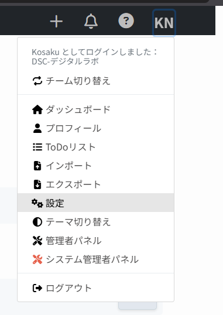
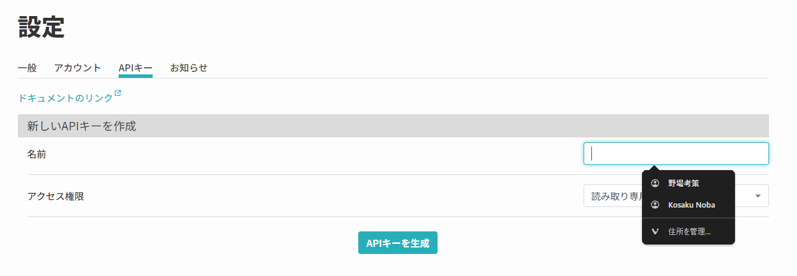
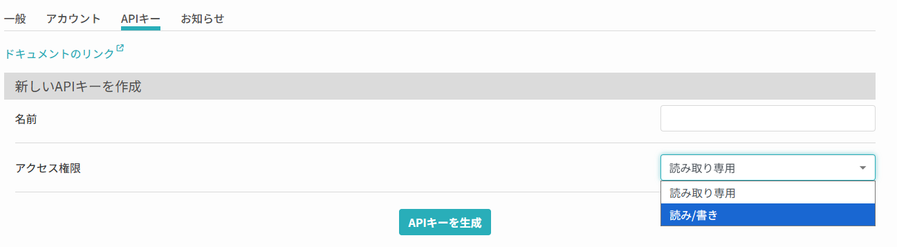
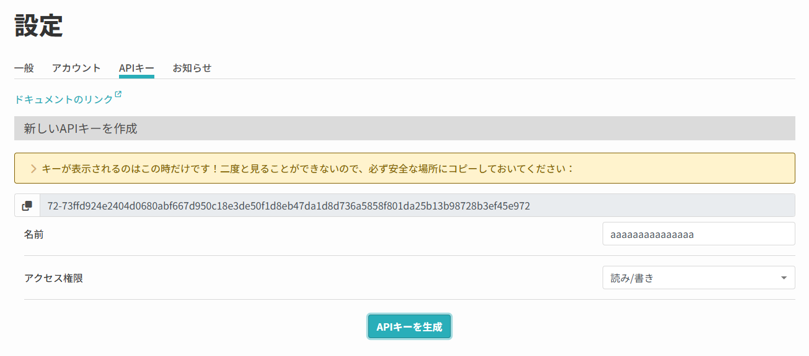

# elab-doc-sync

Markdown ドキュメントを eLabFTW に同期する CLI ツール。`esync` エイリアスでも使えます。

## これは何？

ローカルの Markdown ファイルを eLabFTW のリソースや実験ノートとして管理するツールです。普段使い慣れたエディタで書いて、コマンド一発で eLabFTW に反映できます。eLabFTW 側で編集された内容の取り込み（両側の変更のマージを含む）、画像・添付ファイル・文書間リンクの変換、タグ・カテゴリ・リンクの設定にも対応しています。

## 最近の主な変更

| バージョン | 内容 |
|---|---|
| v1.0 | 安全な pull、バックアップ・復元、紐付けを保持する `mv`、途中失敗からの再開。同期モードは `each` のみ |
| v1.0.1 | `esync rm` でディレクトリ・glob・正規表現を指定 |
| v1.0.2〜v1.0.3 | 差し替えた画像の古い版の削除、別ターゲットの文書へのリンク変換 |
| v1.0.4 | pull で両側の変更を 3-way マージ、前回の同期からの変更を表示する `diff`、文書を指定した `push`、状態ごとの次の操作の案内 |
| v1.0.5 | pull した Markdown の `&gt;` などを戻す、eLabFTW が削除した `<…>` を警告 |
| v1.1.0〜v1.1.2 | 実験ノート・リソースどうしのリンク（`esync relate`、ターゲット設定 `links`）、リンク元・リンク先をパスで指定 |
| v1.2.0 | 新バージョンの更新通知と任意の自動更新（`ELAB_SYNC_AUTO_UPDATE`）、共通オプションをサブコマンド前にも書ける、各コマンドがターゲットのプロファイルで送信 |
| v1.3.0 | `esync search` でキーワード・作成者・日付・最終更新日・タグ・カテゴリ・ステータスによる検索。`--json`・`--body` で AI エージェントに渡せる |
| v1.4.0 | MCP クライアントで検索・同期・追跡管理の30ツールを利用可能。変更操作は既定でプレビュー |

v0.x からの更新は、先に [v1.0への移行と復旧](docs/13_MIGRATION_V1.md) を確認してください。変更履歴は [Changelog](CHANGELOG.md)、検証環境・結果は [リリース検証](docs/14_RELEASE_VALIDATION.md)、詳しい仕様は [docs/](docs/01_README.md) にあります。

---

## まず使えるようにする（初回セットアップ）

### 必要なもの

- Python 3.10 以上
- [uv](https://docs.astral.sh/uv/)

### インストール

```bash
uv tool install --force git+https://github.com/Kosaku-Noba/elab-doc-sync.git
```

### 初期設定（質問に答える）

```bash
esync init
```

```
=== elab-doc-sync セットアップ ===

eLabFTW の URL: https://<eLabFTWへのURL>/
SSL 証明書を検証しますか？ [Y/n]: n
Markdown ファイルを置くディレクトリ（空欄で docs/）:<好きな場所>
同期する Markdown のファイルパターン（空欄で *.md）:
送信先 — items(resources): リソース / experiments: 実験ノート [items]:
送信形式 — md: Markdown のまま / html: HTML に変換 [md]:

```

URL、保存先、送信先を聞かれるので順に答えると `.elab-sync.yaml` が生成されます。

### API キーを設定する

eLabFTW → ユーザー設定 → API Keys でキーを作成し、`.elab-sync.yaml` に貼る:

#### APIキーの設定場所(elabFTW側)



左上ボタンから設定をクリック



設定内のAPIキーから名前を入力



アクセス権限を読み書きに変更



でてきた文字列をコピー(このときしか出ないので注意)

```yaml
elabftw:
  url: "https://your-elabftw.example.com"
  api_key: "ここにキーを貼る"
  verify_ssl: false
```

あるいは環境変数でもOK（設定ファイルより優先されます）:

```bash
export ELABFTW_API_KEY="your_key"
```

接続できるかは `esync whoami` で確認できます。ユーザー名と現在のチームが表示されれば準備完了です。

### Git管理から除外する

`esync init` が作る `.gitignore` には次が含まれます。既に `.gitignore` がある場合は追記されないので、手動で追加してください。APIキーや退避した本文の公開を防ぎ、同期・復旧記録を手元に保持します。

```gitignore
.elab-sync.yaml
.elab-sync-ids/
.elab-sync-backups/
.elab-displaced-*/
.elab-sync-operations/
.elab-sync-recovery.json
```

独自の `id_file` を設定した場合は、専用の親ディレクトリ全体も除外してください。例えば `id_file: .sync-state/team/default.id` なら `.sync-state/team/` を `.gitignore` に追加します。同じ場所に紐付けやリモート本文を含む状態記録も保存するため、IDファイル単体の除外では不十分です。これらの記録は復旧に必要なので、一括削除しないでください。

---

## VS Code から使う

左端の esync アイコンを押すと、上に開いている文書の送信先・記事 ID・同期状態、下にプロジェクト全体の同期一覧が表示されます。文書の差分を開き、差分タブからその文書だけを push できます。「取得待ち」「競合」の文書は、その文書だけを取り込み（pull）、競合マーカーを VS Code で解消できます。[VS Code 拡張のセットアップ](vscode-extension/README.md)

## MCP クライアントから使う

MCP（Model Context Protocol）対応アプリは、標準入出力（stdio）を通じて esync のツールを呼び出せます。サーバーの起動コマンドは `elab-doc-sync-mcp` です。チェックアウトしたリポジトリで `uv sync --extra mcp` を実行し、MCP クライアントに次のサーバーを登録します。2 つの絶対パスはそれぞれアプリのチェックアウトと、操作する同期プロジェクトに合わせてください。

```json
{
  "mcpServers": {
    "elab-doc-sync": {
      "command": "uv",
      "args": ["run", "--project", "/path/to/elab-doc-sync", "--extra", "mcp", "elab-doc-sync-mcp", "--config", "/path/to/project/.elab-sync.yaml"]
    }
  }
}
```

| 操作 | ツール |
|---|---|
| 同期・検索 | `status`, `diff`, `log`, `list`, `search`, `whoami`, `verify`, `profile_list`, `backup_list` |
| 記事・テンプレート | `tag_list/add/remove`, `relate_list/add/remove`, `metadata_get/set`, `category_list/show/set`, `entity_status_show`, `new_list`, `new` |
| 同期・ローカル変更 | `push`, `pull`, `clone`, `link`, `rm`, `mv`, `restore` |

表のスラッシュはツール名の末尾の選択肢を表します（例 `tag_add`）。変更操作の既定値は `dry_run: true` です。例えば `tag_add` に `{"id":42,"entity":"items","tag_name":"確認済み"}` を渡すと予定を確認でき、同じ引数に `"dry_run":false` を加えるとタグを追加します。`tag_add`・`tag_remove` で `id` と `entity` を省くとターゲットの同期済み記事すべてが対象になり、`target` も省くと全ターゲットに適用します。直接指定するパスは設定ファイルのあるディレクトリが基準です。`link.file` は CLI と同じくターゲットの文書ディレクトリが基準です。

`pull` は `auto: true` または `dir` を指定します。`clone` の API キーはサーバープロセスの環境変数 `ELABFTW_API_KEY` で渡します。`dir` を省くと設定ファイルの隣の `elab-clone-<先頭ID>` に保存します。パスや正規表現には空文字列・空白のみの値を指定できません。既定の保存先もシンボリックリンクならエラーになります。接続先は明示した既定プロファイル（`elabftw` または `profiles.default`）の URL を使い、名前付きプロファイルしかない場合や設定のない場所から開始する場合はサーバー起動時に `--clone-url https://elab.example.org` を指定します。`init`、`update`、`entity-status set`、`profile add/remove` は CLI から使います。

ツール応答の `structuredContent` は `exit_code`、`data`、`messages`、`warnings` を含みます。SDK が引数の型などを実行前に拒否した場合は `structuredContent` がなく、`isError` と `content` に理由が返ります。終了コードが非ゼロなら `isError` が立ちます。複数件の操作が途中で止まった場合は `data` で完了した変更を確認できます。タグの部分結果で `result` がない記事は反映状況が未確認です。再試行前に `tag_list` で確認してください。`push` で `prune_attachments: true` を指定すると、プレビューはリモートを読み、文書ごとに削除候補の添付名と ID を返します。添付一覧の取得に成功して候補がなければ `prune_candidates: []`、失敗した文書には `error` が入ります。添付ディレクトリ未設定なら候補欄は省略し、設定先が存在しない場合やリモート ID が未確定の場合は通信せず空配列を返します。失敗時は全体が `exit_code: 1`、`isError: true` となり、成功した文書の結果も `data.targets[].documents[]` から読めます。既存のルート直下の `mcp_server.py` は開発ワークフロー用です。

## 日常の使い方

### 書いたものを eLabFTW に送る（push）

```bash
esync
```

変更があるファイルだけ自動で送信されます。変更がなければスキップ:

```bash
$ esync
  [実験メモ] 変更なし（スキップ）
```

### 送信前に確認だけしたい

```bash
esync --dry-run
```

### 今の状態を確認する（status）

```bash
esync status
```

文書ごとに「最新」「送信待ち」「取得待ち」「競合」などの状態を表示し、続けて次に実行できるコマンドを `→` で案内します。

```text
  [a.md] 競合（#42）
    → 両方の変更をマージ: esync pull（同じ箇所の変更はマーカーで残る）
    → ローカルを採用（eLabFTW を上書き）: esync push --force docs/a.md
    → eLabFTW を採用（ローカルを上書き）: esync pull --id 42 --entity items --force
```

状態ごとの対処は [競合を確認・復旧する](#競合を確認復旧する) を参照してください。

### ローカルと eLabFTW の差分を見る（diff）

```bash
esync diff                 # 全文書
esync diff docs/note.md    # 指定した文書だけ（push と同じ指定方法）
esync diff --json docs/note.md    # 差分・送信先・記事 ID を JSON で確認
esync diff --json --bodies docs/note.md    # 比較した本文も含めて JSON で確認（VS Code 拡張が使用）
```

文書ごとに、前回の同期からの変更を次の 2 つに分けて表示します。

- **ローカルの変更**: 前回同期した時点から、手元で編集した箇所
- **eLabFTW 側の変更**: 前回同期した時点から、eLabFTW で変わった本文・タイトル・カテゴリ・タグ・添付

前回の同期時点と比べるため、eLabFTW が保存時に本文を書き換えた分（箇条書きの記号など）や画像パスの違いは差分に出ません。

### eLabFTW から最新を取得する（pull）

既に同期済みのファイルを再取得:

```bash
esync pull
```

ローカルを編集していない文書は eLabFTW の内容で更新し、ローカルだけを編集した文書はそのまま残します。両側が編集した文書はマージします（[競合を確認・復旧する](#競合を確認復旧する)）。

追跡中の文書を指定して、その文書だけを取り込む（push と同じ指定方法。改名した文書は先に `esync mv <旧パス> <新パス>` で紐付けを移す）。取得後の記事 URL のローカルリンクへの書き換えも、指定した文書だけに行います:

```bash
esync pull docs/note.md
esync pull --json docs/note.md    # 取り込んだ文書のパス・結果・競合の有無を JSON で確認
```

eLabFTW 上の特定の記事をローカルに持ってくる:

```bash
esync pull --id 42 --entity items
```

- `--id` は eLabFTW の記事番号です（URL の末尾やタイトル横に表示される `#42` のような数字）
- `--entity` は記事の種類です:
  - `items`（= リソース）: 試薬、プロトコル、機器情報など
  - `experiments`（= 実験ノート）: 実験記録

複数まとめて取得:

```bash
esync pull --id 42 --id 43 --id 44 --entity items
```

一括取得の前に、同じ ID を指定して `esync pull --id 42 --id 43 --id 44 --entity items --dry-run` を実行すると、添付の保存先の衝突を確認できます。大文字・小文字だけが異なる添付名も衝突します。複数の記事に push 済みの非画像添付は、各記事の同期記録にあり、手元のファイルと取得元の SHA-256 が一致すれば共有できます。

pull 時、ローカルのどのディレクトリに保存するかは **タグ・カテゴリ・タイトル** から自動判定されます（[pull の自動振り分け](#pull-の自動振り分け)）。判定できない場合は対話で聞かれます。

### 一部の文書だけ push する

```bash
esync push docs/note.md            # 1 文書だけ
esync push docs/subdir             # 配下の文書を再帰的に選択
esync push 'docs/note*.md'         # glob
esync push --regex '^2026-'        # ファイル名に正規表現で一致
```

未追跡の文書は新規作成します。指定しなかった文書は送信しないため、変更は次回の push まで残ります。詳細は [CLI リファレンスの push](docs/05_CLI_REFERENCE.md#pushデフォルトコマンド) を参照してください。

### ファイル名を変える

```bash
esync mv docs/旧タイトル.md docs/新タイトル.md
esync push
```

紐付けを保持して移動し、次のpushでタイトルを更新します。自動検出は本文ハッシュが一致し、対応が一意な場合だけ行います。本文編集も伴う移動は `esync mv` を使ってください。

### 文書の追跡解除

```bash
esync rm docs/note.md                  # 文書を保持して同期対象から除外
esync rm 'docs/old*' --dry-run         # glob で選び、対象を事前に確認
esync rm docs/note.md --local          # ローカル Markdown も削除
esync rm --id 42 --entity items        # リモート ID で指定
```

リモートのデータは保持します。解除したファイルは今後の push・status の対象から除外されます。ディレクトリ・正規表現での指定や再登録方法は [CLI リファレンス](docs/05_CLI_REFERENCE.md#rm--追跡解除) を参照してください。

### 競合を確認・復旧する

```bash
esync status
esync diff
esync pull --dry-run
esync backup list
esync restore <バックアップID> --dry-run
esync restore <バックアップID>
```

通常のpullはローカル未編集の文書を更新し、ローカルだけの変更は保持します。上書き・削除・移動前にバックアップを保存し、復元直前の状態も退避します。

両側が本文を変更した文書（状態「競合」）は、pull で git と同じようにマージします。

- 前回の同期時点の本文を基準に、片側だけが変えた箇所はそのまま取り込みます
- 両側が同じ箇所を別々に変えた場合は、その箇所を両方残してマーカーで囲みます

```text
<<<<<<< ローカル
ローカルの内容
=======
eLabFTW の内容
>>>>>>> eLabFTW #42
```

- マーカーが残った文書があると pull は終了コード 1 を返し、文書の一覧を表示します。マーカーを消して内容を整えてから push してください。マーカーが残っている間、その文書の push と通常の pull は止まり、`status` は「競合マーカーあり」を表示します。`push --force` でも送信しません。`pull --force` はマーカーごとローカルを eLabFTW の内容で上書きします（変更前の文書はバックアップされます）
- マージ結果は eLabFTW にはまだ送っていないため、状態は「送信待ち」になります。push で送信してください
- 判定に使うのは esync が付けるマーカー（`<<<<<<< ローカル` と `>>>>>>> eLabFTW`）だけです。文書中の git のマーカー例や、見出しの下線の `=======` は競合と扱いません
- v1.0.4 より前に同期した文書は基準の本文が保存されていないため、両側の差がある箇所をすべてマーカーで示します。次に同期した時点から基準を保存します
- マージ時、画像・非画像添付とも、取得先のファイルが前回の SHA-256 に一致すれば新版を取得します。以前の記録に SHA-256 がない状態でリモートが差し替わると、手元が未編集でも照合できず停止する場合があります。同じファイル名に複数の添付 ID があり本文が指す版を選べない場合、手元とリモートで添付を異なる内容に変更した場合や、マージ後の本文が古い画像・添付を指すおそれがある場合は停止します。本文と添付を別の場所に保存し、両側の内容を確認してください
- マージせずにどちらかを採用する場合は、`pull --force` または `push --force` を使います

**復元はバックアップに記録されたディレクトリまたはファイル全体に適用されます。** 保存後に追加したファイルも復元先から取り除かれるため、必ず `restore --dry-run` で範囲を確認してください。バックアップは自動削除されません。世代を手動で削除する前に、`displaced-location.json` があればエディタを閉じ、記録された `path` の本文に必要な編集が残っていないか確認してください。世代を削除しても文書側の `.elab-displaced-*/body` は残ります。

`pull --force` はローカルを退避して上書きします。同じ名前の本文を再取得する場合も、画像・添付の取得中に本文が編集されたことを検出するとその記事の取得は停止します。復元前に作業場所の本文と警告に表示された置換直前の版を確認し、必要な編集を復元対象の外にコピーしてください。[本文の退避先と復元手順](docs/05_CLI_REFERENCE.md#mv--backup--restore--link)

`push --force` はリモート本文を退避して上書きします。リモート本文の退避データは復元時にJSONへ取り出し、確認後に手動で反映します。

主な状態と対処は次のとおりです。

| 状態 | 対処 |
|---|---|
| 最新 | 操作不要 |
| 送信待ち | `push` でローカルの変更を送る |
| 取得待ち | `pull` でリモートの変更を取得する |
| 競合 | `pull` でマージする。マーカーが残ったら解消して `push`。マージせずに片側を採用する場合は `push --force` または `pull --force` |
| 競合マーカーあり | 文書のマーカーを解消してから `push` |
| 基準情報なし | `diff` で確認し、採用する側を決めてから `push --force` または `pull --force` |
| リモート削除 | eLabFTW で記事が削除された。強制pushでも再作成しない。追跡をやめるなら `rm <ファイル>`、作り直すなら `rm <ファイル>` → `link --new --file <ファイル名>` → `push <ファイル>` |
| 同期未完了 | 前回の push が途中で止まった。`push` で再開する。eLabFTW 側が変わって再開できない場合は、`push --force <ファイル>`（ローカルを採用）または `pull --id <ID> --entity <種別> --force`（eLabFTW を採用） |
| 確認失敗 | 接続・APIキーを確認して再実行する |

新規作成の応答が失われた場合は、重複作成を避けるため停止します。サーバー上の記事を確認し、存在すれば `link`、存在しないと確認できた場合だけ `link --new --file <ファイル名>` で再開します。

移行・復元範囲・途中失敗の扱いは [v1.0への移行と復旧](docs/13_MIGRATION_V1.md) を参照してください。

---

## 応用: こういう場面ではこうする

### eLabFTW にある既存プロジェクトをローカルに持ってきたい

```bash
export ELABFTW_API_KEY="your_key"
esync clone --url https://elab.example.com --entity items --id 42 --id 43
```

`elab-clone-42/` にプロジェクトディレクトリ一式（`.elab-sync.yaml`・`.gitignore`・取得した文書）が生成されます。`--dir` で名前を変えられます。

### 別の PC や共同編集者と同じ文書を扱いたい

同期状態（`.elab-sync-ids/`）は PC ごとに持ち、Git では共有しません。別の PC で同じ記事を扱うときは、その PC で記事と文書を紐付けてから使います。紐付けずに push すると、eLabFTW に別の記事として新規作成されます。

**文書を Git で共有していない場合**: eLabFTW から取得します。

```bash
esync pull --id 42 --id 43 --entity items
```

**文書を Git で共有している場合**: 既にある文書を記事に紐付けます。

```bash
esync list                                        # 記事の ID を確認
esync link 42 --file note.md --target docs        # --file は docs_dir からの相対パス
esync diff docs/note.md                           # 紐付けた時点の eLabFTW の本文との差を確認
```

**紐付けた直後の差は pull ではマージされません。** `link` は紐付けた時点の eLabFTW の本文を同期の基準にするため、手元の文書との差はすべて「ローカルの変更」（送信待ち）として扱われます。手元の文書が古いまま push すると、eLabFTW 側にしかない追記が消えます。紐付けたら `esync diff` で差を確認し、次のどちらかにしてください。

- eLabFTW の内容を採用する: `esync pull --id 42 --entity items --force`（手元の文書はバックアップされる）
- 両方の内容が必要: 手元の文書を手で統合してから `esync push`

差がなければ（`diff` に「ローカルの変更」が出なければ）そのまま使えます。紐付けの前に `git pull` で文書を最新にしておくと、差を小さくできます。

紐付けた後は、普段どおり作業の前に `esync pull`、後に `esync push` します。eLabFTW の画面で誰かが編集していても、pull で両側の変更をマージできます（同じ箇所の変更はマーカーで残ります）。

### 週報と実験メモを別ディレクトリで管理したい

`.elab-sync.yaml` でターゲットを分ける:

```yaml
targets:
  - title: "週報"
    docs_dir: "weekly_reports/"
    entity: items
    tags: ['週報']
    title_pattern: "*週報*"    # pull 時のタイトル自動振り分け

  - title: "実験メモ"
    docs_dir: "experiments/"
    entity: experiments
```

push 時は各 `docs_dir` から送信され、pull 時はタグやタイトルから適切なディレクトリに自動配置されます。`esync -t 週報` のように `title`（または `docs_dir`）で 1 つのターゲットだけを対象にできます。

### 別チームの eLabFTW にも投稿したい（複数 API キー）

eLabFTW の API キーはチームごとに発行します。プロファイルにキーとチームを登録し、ターゲットで `team`（または `profile`）を指定します。

```yaml
profiles:
  TeamA:
    url: "https://elab.example.com"
    api_key: "59-xxxx..."
    team: "TeamA"
  TeamB:
    url: "https://elab.example.com"
    api_key: "60-yyyy..."
    team: "TeamB"

targets:
  - docs_dir: "docs/"
    team: "TeamA"          # 同じ team のプロファイルのキーで送信
  - docs_dir: "TeamA_docs/"
    team: "TeamA"
  - docs_dir: "TeamB_docs/"
    profile: TeamB          # プロファイル名で直接指定することもできる
    tags: ['共同研究']
```

プロファイルはコマンドでも追加できます。各キーのチームは `esync whoami` で確認できます。

```bash
esync profile add team-b --url https://elab.example.com --api-key "team-b-key"
esync profile add team-c --url https://elab.example.com --api-key-env TEAM_C_ELABFTW_API_KEY   # キーを設定ファイルに書かない
esync profile list
esync whoami
```

push・pull・`tag`・`relate`・`metadata`・`entity-status`・`verify` は、ターゲットごとにその接続先で送信します。`category`・`list`・`new` は `-t` で選んだターゲットの接続先を使います。

### eLabFTW のテンプレートから実験ノートを書き始めたい

```bash
esync new --list                                  # 実験テンプレートの一覧
esync new --template-id 3 --title "2026-10-21 培養" -t 実験メモ
esync push
```

テンプレートの本文を Markdown に変換し、`-t` のターゲット（省略時は最初のターゲット）の `docs_dir` に保存します。`-o` で保存先を指定できます。

### タグやカテゴリを操作したい

```bash
esync tag list                                      # 同期済みの全文書のタグ
esync tag --dry-run add "重要"                      # 追加される文書を事前に確認（送信しない）
esync tag add "重要"                                # 同期済みの全文書に追加
esync tag add "new-tag" --id 42 --entity items      # 記事を指定
esync category list --entity items
esync category set "試薬" --id 42 --entity items
```

`--id` を省略すると、各ターゲットの同期済み文書に、そのターゲットの接続プロファイルで送信します。`--id` を指定した場合、接続先は `-t` で選んだターゲットのプロファイルです（`-t` を省略すると default、一致するターゲットがなければ何も送信せずエラー）。

```bash
# 上の例の TeamB_docs/（profile: TeamB）側の記事 #42 にタグを追加
esync tag -t TeamB_docs add "new-tag" --id 42 --entity items
```

`tag`・`category`・`relate`・`metadata`・`entity-status` の変更と `new` は `--dry-run` で予定だけを確認できます。eLabFTW から現在の値を読む通信は行いますが、変更は送信しません（`new` はファイルを作りません）。

push のたびに付けたいタグ・カテゴリは、ターゲットの `tags`・`category` に書きます。push はタグを追加するだけで外さないため、外すときは `esync tag remove` を使います。

### ステータスやメタデータをまとめて変更したい

```bash
esync entity-status -t 実験メモ show                 # 各文書の現在のステータス
esync entity-status -t 実験メモ --dry-run set 2      # 現在のステータスと変更予定を確認
esync entity-status -t 実験メモ set 2                # 全文書を変更（確認あり）
esync metadata -t 実験メモ set project=A phase=2     # メタデータ（JSON）に追記
```

`-t` は `show`・`set` などより前に書きます。ステータスはチーム設定のステータス ID で指定します。`--id 42` で 1 件に絞れますが、`-t` を省略すると全ターゲットそれぞれの #42 が対象になるため、`-t` と組み合わせてください。

### 実験ノートやリソースどうしをリンクしたい

eLabFTW の「リンク」（実験ノート・リソースの関連付け）を張れます。

```bash
# リソース #42 から実験ノート #12, #15 にリンク
esync relate add 12 15 --to experiments --id 42 --entity items

# 同期済みの文書はパスで指定できる（リンク元は --from、種別は自動で決まる）
esync relate add "SPECIFICATION/仕様書.md" --from exp/2026-10-20.md

# リンク一覧・解除（リンク先の記事は消えません）
esync relate list --from exp/2026-10-20.md
esync relate remove 15 --to experiments --id 42 --entity items
```

`--from` の後ろはすべてリンク元になるため、リンク先は `--from` より前に書きます。`--from` も `--id` も省略すると、全ターゲット（`-t` 指定時はそのターゲット）の同期済みの全文書がリンク元になります。

同期する文書に決まったリンクを張りたい場合は、ターゲットに `links` を書きます。push 時に、そのターゲットの全文書から指定した記事へのリンクを追加します（追加のみで、既存のリンクは外しません）。

```yaml
targets:
  - docs_dir: "docs/"
    entity: experiments
    links:
      items: [42, 43]        # リソース（resources とも書ける）
      experiments: [12]      # 実験ノート
```

指定方法の詳細とエラーの条件は [CLI リファレンスの relate](docs/05_CLI_REFERENCE.md#relate--実験ノートリソース間のリンク)、`links` の挙動（記録・再試行・張り直し）は [設定ファイル仕様の links](docs/04_CONFIGURATION.md#links実験ノートリソースへのリンク) を参照してください。

### リモートに何があるか・何をしたか見たい

```bash
esync list                        # リソース一覧
esync list --entity experiments   # 実験ノート一覧
esync search --author me --updated-since 2026-11-01   # 自分が最近更新した記事を検索
esync search PCR --tag 週報 --json                     # キーワード・タグで検索して JSON で出力
esync verify                      # 紐付けた記事にアクセスできるか確認
esync log                         # 最近の push・pull の履歴
```

### ファイルを既存のエンティティに手動で紐付けたい

```bash
esync link 42 --file "実験メモ.md"
```

`--file` は `docs_dir` からの相対パスです。ターゲットが複数ある場合は `--target` も指定します。

### PDF や CSV も一緒に送りたい（添付ファイル）

```yaml
targets:
  - docs_dir: "docs/"
    attachments_dir: "attachments/"
    entity: items
```

`docs/週報.md` から `[測定結果](../attachments/result.csv)` のようにインラインリンクを書くと、その週報に `result.csv` が添付されます。リンクのない文書は、添付ディレクトリを共有していてもファイルを送りません。`--force` でも、同じ記事にある同名・同内容の添付 ID を再利用します。参照形式（`[測定結果][csv]`）でローカルファイルを添付したい場合はインラインリンクに書き換えてください。

`attachments_dir` を設定すると、pull はこの記事の添付一覧と一致するインラインのダウンロードリンクをローカルパスに戻します。`.md` の添付、ページ指定付き URL、動画の HTML 埋め込みはこの変換の対象外です。動画や PDF を編集して送る場合は、ローカルファイルへのインラインリンクを本文に書いてください。`.md` のローカルリンクは文書間リンクとして扱います。初回の pull でも、画像・添付の保存先に別の内容がある場合は上書き前に停止します。手元のファイルと記事の添付を確認し、必要なら別名で保存してください。`pull --force` の途中で別の編集が入った場合も、置換前の実ファイルを退避して停止します。`restore` の前に、警告が示す編集版を復元対象の外にコピーしてください。

v1.3.0 が送った添付は記事に残ります。初回の更新時は旧版のディレクトリ全体のハッシュと比較するため、未編集の記事でも「送信待ち」や「競合」になる場合があります。`esync diff` で確認してください。

本文から参照している画像・ファイルを同じ名前のまま差し替えると、push 時に新しい版をアップロードし、本文から参照されなくなった古い版の添付を削除します（`--prune-attachments` は不要）。同じ記事に手動で追加した同名の CSV も、元の本文が参照していなければ残ります。通常の push でも、本文のアップロード中に既存添付が改名されたり、新版を確認できなかったりすると、本文更新と旧版削除を中止します。同じ記事の本文・タイトル・本文形式・カテゴリ・タグ・添付の変更を本文送信前に検出すると停止します。たとえば初めて本文に画像を貼る場合も、準備中に別の利用者が同じ記事に添付を追加すると停止します。送信済みの新版は残ることがあります。`esync diff` で追加・変更を確認してください。

添付ファイル送信時のタイムアウト・接続断・5xx・リダイレクトでは送信前後の一覧を照合し、新規 ID、名前、SHA-256 から今回の添付を一意に特定できれば続行します。特定できない場合は自動再送を止めます。`esync diff` と eLabFTW の添付一覧で対象記事を確認してください。

ID 受領後の照合で通信が切れたときは、復旧後に同じ文書を通常の `push` で再照合できます。保存確認済みの本文を別の利用者が元の版に戻した場合も、変更として扱って停止します。受領した ID が一覧にまだないと表示されたら、その ID が現れてから同じ文書に `esync push <ファイル>` を再実行します。「URL が未反映です」と表示された場合も受領 ID を保持します。その ID の URL が一覧に現れてから同じ文書を通常の push で再実行してください。本文用添付は、受領記録と同名・同内容のファイルを再開するとき、その記録の ID だけを再利用します。「本文に使う添付 URL が変わりました」「保存された本文の添付リンクを確認できません」と表示されたら、eLabFTW の記事でリンク先と添付一覧を突き合わせてください。本文の保存後に止まった場合もあります。0 バイトの添付も対象です。本文、名前、内容などの差異を確認し、ローカル版を採用するときだけ `push --force <ファイル>` を使います。送信・照合した版とローカルの内容が一致すると「最新」、その版を手元で編集すると「送信待ち」になります。

`--prune-attachments` は、attachments_dir が存在する場合、attachments_pattern に一致し、同名のローカル添付も本文からの参照もない非画像添付を削除する push のオプションです。例えば別ホストの `https://other.test/remove.csv` は同名の添付を保護しません。接続先の `/uploads/%31%30%30` を参照するリンクは ID 100 を保護します。削除した添付は esync のバックアップからは復元できません。`esync push --dry-run --prune-attachments` はリモートの添付一覧を読み、`attachments_pattern` に一致する非画像添付のうちローカル添付ディレクトリに同名ファイルがなく、本文のリンクにも使わない削除候補の ID と名前を表示します。一覧取得や本文中の URL の照合に失敗した文書は理由を表示し、残りの文書の確認を続けます。実行中に別の利用者が本文や添付を編集したことを検出すると、次の削除を中止します。通信が途切れた場合は `esync diff` で状態を確認し、削除済みの添付はそのままです。通信復旧後、タイトル、本文とその形式、カテゴリ、タグ、残った添付が復旧記録と一致すれば、同じ対象で `esync push --prune-attachments` を再実行して残りを整理できます。誰かが添付を改名するなど記録と異なる変更があると自動再開は停止します。`esync diff` で内容を確認し、[「競合を確認・復旧する」の「同期未完了」](#競合を確認復旧する) の手順に従ってください。

`[測定](data.csv "測定条件")` を送信すると、CSV の URL だけが変わり、ラベルとタイトルは保存されます。

インラインコードやコードブロックに書いた Markdown のリンク例はそのまま残り、プレビューの「画像」「動画」「リンクファイル」の各件数からも除外されます。たとえば `result.csv` がコード例の相対リンクにだけ現れ、添付ディレクトリにも同名ファイルがなく、その添付 ID やダウンロード URL への参照がない場合、パターンに一致するリモート添付は `--prune-attachments` の削除候補になります。同期済み記事に解決できる `[手順](guide.md)` は同名の添付を保護しません。複数のターゲットをまとめて push する場合も、最初の記事を書き込む前に全ターゲットの削除候補を確定します。新規記事に ID が付きリンクが解決しても、削除候補は増えません。参照形式のリンク（例 `[測定][data]` と定義 `[data]: result.csv`）として表示される場合は保持します。

画像・動画・ファイルリンク・添付の送信対象は、プロジェクト内の通常ファイルに限定します。プロジェクト外への参照、隠しファイル・隠しディレクトリ、シンボリックリンクは拒否します。[送信制約と復旧](docs/13_MIGRATION_V1.md#バックアップと復元) も参照してください。

### 数式を使いたい

```yaml
targets:
  - docs_dir: "docs/"
    body_format: md    # ← Markdown のまま送信（MathJax でレンダリング）
```

```markdown
インライン: $E = mc^2$

ブロック:
$$\frac{\partial f}{\partial x} = 2x + 1$$
```

`body_format: md` では、eLabFTW が本文の `<…>`（`array<string>` の `<string>` など）を HTML タグとして削除します。esync は警告を出すので、山かっこを使わない表記に改めてください。

### ファイル間リンクを貼りたい

同期済みの `.md` ファイル同士は、普通の Markdown のリンクで参照できます:

```markdown
詳しくは [セットアップガイド](./setup.md) を参照。
```

push 時にローカルリンクが eLabFTW の記事 URL に、pull 時に記事 URL がローカルリンクに変換されます。別のターゲット（`docs_dir`）の文書へのリンクも変換されます（接続先のホストが同じ場合）。未同期の文書へのリンクはそのまま残るので、リンク先を先に push してください。変換の詳細は [同期エンジンの文書間リンクの変換](docs/07_SYNC_ENGINE.md#文書間リンクの変換) を参照してください。

### スクリプトや定期実行で使いたい

```bash
export ELABFTW_API_KEY="your_key"
set -e                 # 失敗したらそこで止め、非ゼロで終了する
esync pull --auto      # 競合マーカーが残った・通信に失敗したなどは終了コード 1
esync push
```

- 終了コードは、成功・変更なしで 0、競合・通信失敗・部分失敗で 1、設定や引数の不正で 2 です。pull が失敗したまま push に進まないよう、上の例のように失敗で止めてください
- `pull --auto` は、保存先の振り分けが曖昧でも対話で聞かずにスコア最大のターゲットを選びます
- `entity-status set` は複数件を変更するとき確認を求めます。自動化では `--id` で 1 件ずつ指定してください
- 同じプロジェクトで esync が既に動いている場合は「別のesyncが実行中です」で終了します（終了コード 1）

---

## pull の自動振り分け

`esync pull --id` で新しいエンティティを取得する際、以下の順で保存先を決定します:

1. **既に紐付け済み** → そのディレクトリへ再同期
2. **開始時点で対象種別のターゲットが1つだけ** → そのターゲットの `docs_dir` へ
3. **複数ターゲット** → タグ/カテゴリ/タイトルでスコアリング
4. **判定できない** → 対話で選択 or `--auto` で最高スコアを採用

未追跡 ID の候補が複数あるときは、そのすべてで URL・API キー・SSL 検証設定が一致する場合に共通の接続先から取得します。接続先が複数なら、`--auto` を使う場合も `esync pull --id 42 --entity items --target 週報` のように取得元を指定してください。指定したターゲットと種別や保存先の接続設定が矛盾すると取得前にエラーになります。同じ接続先の候補から対話で新規ディレクトリを作成した場合、新規ターゲットは設定順で最初の候補の `profile` と `team` を引き継ぎます。

スコアリング:

- `title_pattern` (glob) マッチ: +10
- `category` 一致: +10
- `tags` の包含率: 最大 5 + 特異性ボーナス

判定を常に自動で行いたい場合:

```bash
esync pull --id 42 --entity items --auto
```

`--dir` で保存先を明示することもできます。マッチするターゲットがない場合、リモートのメタデータから新しいターゲットが `.elab-sync.yaml` に自動追記されます。

---

開始時に対象種別の候補も `--dir` の指定もない場合、各記事のカテゴリ、先頭タグ、種別名の順で保存先を選びます。カテゴリが A・A・B の 3 件なら A/ に 2 件、B/ に 1 件を保存します。

画像・添付の保存先が追跡文書と重なる場合、同じ記事の取得でも `--force` で上書きできません。例えば添付の `note.md` が追跡中の文書に重なる場合は、`attachments_dir` を別の場所に指定してください。接続先の記事の添付と確認できた画像は文書と同じディレクトリの `images/` に保存します。別サーバーや別記事の画像は元の URL のまま残ります。そこを別種別や別接続先のターゲットが管理している場合は、文書の保存先またはターゲット配置を変えてください。`docs/images` が通常ファイルなら、そのファイルを移すか本文の保存先を変えてください。初回取得でも、本文と添付がともに `docs/new.md` になる場合は、プレビュー時点でその記事をエラーにします。

自動振り分けで決まる保存先にも同じ種別・接続設定の照合を行います。別種別や別接続先のターゲットと重なると、その記事の取得は失敗します。別の保存先を `--dir` で指定してください。

## 同期モード

`each`（1ファイル＝1記事）のみ対応します。旧 `merge` 設定は [移行手順](docs/13_MIGRATION_V1.md#mergeを使っていた場合) に従って変更してください。

---

## コマンド一覧

| コマンド | やること |
|---|---|
| `esync` / `esync push [ファイル]` | push（ローカル → eLabFTW）。ファイル・ディレクトリ・glob・`--regex` で文書を指定可 |
| `esync pull` | pull（eLabFTW → ローカル）。`--id 42 --entity items` で記事を指定 |
| `esync status` | 同期状態と次の操作の案内 |
| `esync diff [ファイル]` | 前回の同期からのローカル・eLabFTW の変更を文書ごとに表示 |
| `esync clone` | eLabFTW の記事からプロジェクトを構築 |
| `esync list` | リモート一覧 |
| `esync search` | 作成者・日付・タグ・カテゴリなどで検索（`--json` で機械可読） |
| `esync link <ID>` | 手動紐付け（`--new` で新規追跡を再開） |
| `esync rm <ファイル>` | 追跡解除（`--local` でローカルファイルも削除） |
| `esync mv <旧パス> <新パス>` | 文書と紐付けを移動 |
| `esync backup list` | バックアップ一覧 |
| `esync restore <ID>` | ローカル復元・リモート退避データの取り出し |
| `esync tag list/add/remove` | タグ操作 |
| `esync category list/show/set` | カテゴリ操作 |
| `esync relate list/add/remove` | 実験ノート・リソース間のリンク操作 |
| `esync metadata get/set` | メタデータ操作 |
| `esync entity-status show/set` | ステータス操作 |
| `esync new` | 実験テンプレートから文書を作成 |
| `esync verify` | 紐付けの整合性チェック |
| `esync log` | 同期ログ表示 |
| `esync profile list/add/remove` | 接続プロファイル管理 |
| `esync whoami` | API キーのユーザー・チームを表示 |
| `esync init` | 初期設定 |
| `esync update` | ツール更新 |

共通オプション: `--dry-run`（`-n`）実行せず確認、`--force`（`-f`）強制同期、`-t "名前"` 特定ターゲットだけ、`--config`（`-c`）設定ファイル。`esync -t 名前 push` と `esync push -t 名前` のどちらの順でも書けます。全オプションは [CLI リファレンス](docs/05_CLI_REFERENCE.md) を参照してください。

---

## 設定リファレンス

### 接続設定

```yaml
# 方法1: 従来形式（1サーバー）
elabftw:
  url: "https://elab.example.com"
  api_key: "your_key"
  verify_ssl: true

# 方法2: profiles（複数サーバー/チーム）
profiles:
  default:
    url: "https://elab.example.com"
    api_key: "key-a"
    verify_ssl: true
    team: "TeamA"        # 任意。ターゲットの team からプロファイルを選ぶのに使う
  team-b:
    url: "https://elab.example.com"
    api_key: "key-b"
    verify_ssl: true
    team: "TeamB"
```

環境変数 `ELABFTW_API_KEY` は default プロファイルの api_key を上書きします（`api_key_env` を書いたプロファイルを除く）。

送り先ごとに別のキーを使うフォルダでは、キーを設定ファイルに書かず、`api_key_env` に環境変数の**名前**を書けます（`elabftw:` の欄と各プロファイルで使えます）。

```yaml
profiles:
  default:
    url: "https://elab.example.com"
    api_key_env: UPTEST_ELABFTW_API_KEY   # 環境変数 UPTEST_ELABFTW_API_KEY の値を API キーに使う
    team: "TeamA"
```

優先の順は次のとおりです。

1. `api_key_env` に書いた名前の環境変数（設定されていて空でないとき）
2. `api_key_env` を書いていない default プロファイル（と `elabftw:` の欄）だけ、`ELABFTW_API_KEY`
3. 設定ファイルの `api_key`

`api_key_env` を書いたのに環境変数が未設定または空のときは、`ELABFTW_API_KEY` や `api_key` に切り替えず、環境変数の名前を示してエラーにします（別の送り先へ別のキーで接続する事故を防ぐため）。名前付きのプロファイルは、使うターゲットを実行するときにエラーになります（`default` も `elabftw:` もなく、最初のプロファイルが既定の接続先になる場合は、設定の読み込み時にエラーになります）。環境変数の名前は、半角英字またはアンダースコアで始まり、半角英数字とアンダースコアだけで書きます。`api_key_env` を書かない設定の動作は変わりません。キーの値はエラーにも表示しません。記入例は [`.elab-sync.yaml.example`](.elab-sync.yaml.example) にあります。

### ターゲット設定

| キー | 必須 | デフォルト | 説明 |
|---|---|---|---|
| `docs_dir` | ✅ | — | Markdown ディレクトリ |
| `title` | — | 空文字 | CLIでターゲットを指定する名前。記事タイトルはファイル名から決定 |
| `pattern` | — | `*.md` | Glob パターン |
| `mode` | — | `each` | 1ファイル＝1記事（`each` のみ） |
| `entity` | — | `items` | `items`（`resources`） / `experiments` |
| `profile` | — | `default` | 使用する接続プロファイル |
| `team` | — | — | 送信先チーム名または ID。`profile` を省略した場合、同じ `team` のプロファイルを使う |
| `tags` | — | `[]` | push 時に自動追加するタグ（pull 振り分けにも使用） |
| `category` | — | — | push 時のカテゴリ。名前または数字の ID（pull 振り分けにも使用）。一覧 API に出ない（読み取り権限のない）カテゴリは ID で指定 |
| `links` | — | — | push 時に追加するリンク。`experiments` / `items`（`resources`）ごとの ID のリスト。削除はしない |
| `title_pattern` | — | — | pull 振り分け用タイトル glob |
| `body_format` | — | `html` | `md` / `html`（`esync init` で作ると `md`） |
| `attachments_dir` | — | — | pull で非画像添付を保存するディレクトリ。送信するファイルは各文書のリンクで指定 |
| `attachments_pattern` | — | `*` | `--prune-attachments` の削除候補名を絞る glob。本文にリンクしたファイルはこのパターンにかかわらず送信 |
| `id_file` | — | `.elab-sync-ids/{docs_dir}/default.id` | 状態ディレクトリの指定（このパスの親ディレクトリを使う） |

詳細は [設定ファイル仕様](docs/04_CONFIGURATION.md) を参照してください。

---

## トラブルシューティング

「保存先の追跡情報を一意に選べません」「新しい保存先の追跡情報が既存ターゲットと重複します」が出たら、前者は同じ保存先に異なる `id_file` の親ディレクトリが設定されています。後者は新しい保存先用の `id_file` の親ディレクトリを別のターゲットが使用しています。設定の `docs_dir` と `id_file` を確認してください。

pull で `HTTP 403（権限がありません）` が表示された場合は、取得元のプロファイルと対象文書の閲覧権限を確認してください。

| メッセージ | やること |
|---|---|
| `API キーが設定されていません` | `.elab-sync.yaml` の api_key を確認 |
| `設定ファイルが見つかりません` | `esync init` を実行 |
| `… に一致するファイルがありません` | `docs_dir` に `.md` ファイルを置く |
| タイムアウト | 状態と未完了記録を確認して再実行。記事の作成結果が不明ならlist/linkで確認 |
| `警告: eLabFTW が本文の <…> を削除しました` | eLabFTW が `array<string>` の `<string>` などをタグとして消しています（コードで囲んでも消えます）。eLabFTW 側では失われ、pull でも戻りません。ローカルの原稿で山かっこを使わない表記に改めて再度 push（解消するまで「送信待ち」のまま） |
| `別のesyncが実行中です` | 同じプロジェクトで実行中の esync の終了を待って再実行 |

その他のエラーは [トラブルシューティング](docs/09_TROUBLESHOOTING.md) を参照してください。

### 新バージョンの通知

新しいバージョンが公開されていると、コマンド実行後に `💡 新しいバージョンがあります: 1.1.2 → 1.2.0` と表示されます。`esync update` で更新してください。コマンドの実行中にエラーになったとき（eLabFTW に接続できない場合など）も表示します。ただし、引数の書き間違いによるエラーと `esync update` 自体では表示しません。確認は 1 日 1 回、端末に出力しているときだけで、GitHub 上のバージョンを読めないとき（オフラインなど）は何も表示しません。結果は 1 日キャッシュされます。止めたいときは環境変数 `ELAB_SYNC_NO_UPDATE_CHECK=1` を設定します。

**自動更新（任意）**: 環境変数 `ELAB_SYNC_AUTO_UPDATE=1` を設定すると、新しいバージョン（マイナー・パッチ）を見つけたときに `esync update` 相当をバックグラウンドで自動実行します。更新は実行中のコマンドが終わってから反映されるため、新しい版が使われるのは次回の実行からです。メジャーバージョンが上がる更新は自動では行わず、通知だけ表示します。同じバージョンへの自動更新は 1 度しか試しません（失敗したら `esync update` を手動で実行してください）。通知と同様に、端末に出力しているときだけ動きます。更新先は検出したバージョンのタグ（`v1.2.0` など）に固定します。タグがまだ公開されていないときは自動更新せず、通知だけにします（未公開は 1 日後、GitHub に問い合わせできなかったときは 1 時間後に再確認します）。`ELAB_SYNC_NO_UPDATE_CHECK=1` を設定している場合は、通知だけでなく自動更新も行いません。

### `esync update` したのにバージョンが古いまま

**原因**: プロジェクトの `.venv` 内に古い `esync` が残っており、PATH 上で `uv tool` 版より優先されている。

**確認方法** (PowerShell):
```powershell
Get-Command esync | Select-Object -ExpandProperty Source
# .venv\Scripts\esync.exe が表示されたら PATH 優先度の問題
```

**解決方法**:
```powershell
# プロジェクトディレクトリで実行（.venv から孤立パッケージを削除）
uv sync
```

その後、新しいターミナルを開いて `esync --version` で確認。

**防止策**: `elab-doc-sync` をプロジェクトの `pyproject.toml` の dependencies に追加しない（ユーザーツールとして `uv tool` で管理する）。

---

## 開発

検証結果と正式リリース条件は [リリース検証](docs/14_RELEASE_VALIDATION.md) を参照してください。

```bash
git clone https://github.com/Kosaku-Noba/elab-doc-sync.git
cd elab-doc-sync
uv sync --extra test --extra mcp
uv run --extra test --extra mcp pytest -q -m "not integration"
```

## ライセンス

MIT
