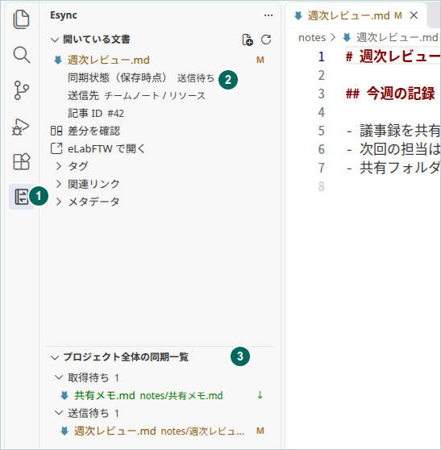
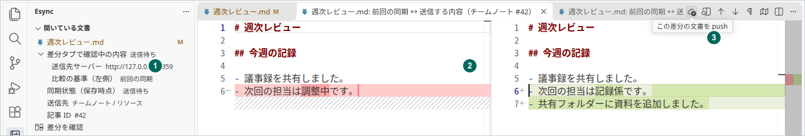
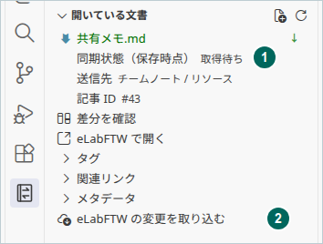
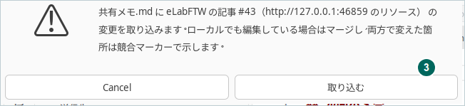
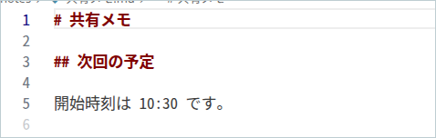
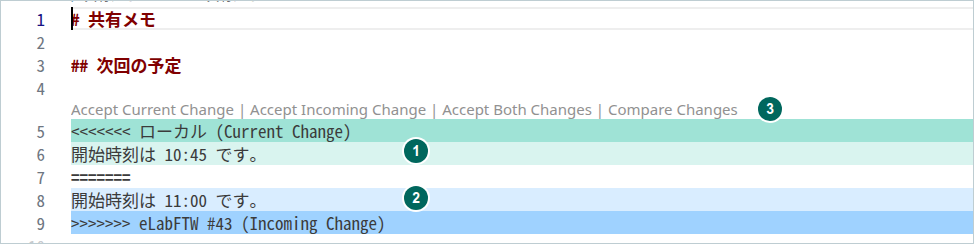
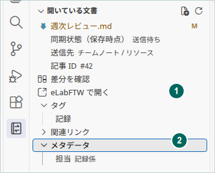
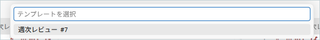
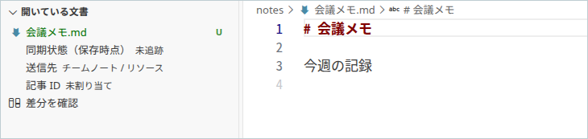
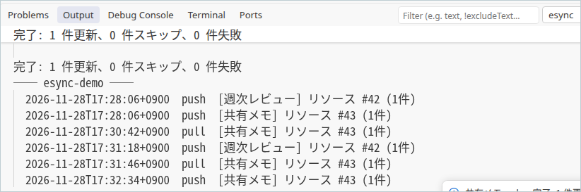

# esync操作マニュアル

VS Code 拡張 0.3.0 ／ esync CLI 1.5.0。実画面で、差分の確認、送信、取り込み、競合解消を説明します。

[PDF版を開く（全6ページ）](esync-guide/esync-vscode-guide.pdf)

## 1. 同期する文書を開く

esync の CLI と VS Code 拡張をインストールしてから始めます。まず、どの文書をどの記事と同期するか確かめます。



図1　サイドバー。週次レビューは送信待ち、共有メモは取得待ち。

1. **プロジェクトを開く**　VS Code の「ファイル」→「フォルダーを開く」で、`.elab-sync.yaml` があるフォルダーを選びます。対象の Markdown を開き、左端のノート形の **esync** アイコンを押します。
2. **開いている文書を確かめる**　「開いている文書」でファイル名・送信先・記事 ID を確認します。図では「週次レビュー.md」の送信先は「チームノート」のリソース **#42** です。
3. **プロジェクト全体を見る**　下の一覧は同期状態ごとに並びます。文書の行を押すと開けます。最新の状態を取り直すには、パネル右上の丸矢印「同期状態を更新」を押します。

> **画面に esync が出ないとき**　すでに開いていたウィンドウでは、コマンドパレットで「Developer: Reload Window」を実行します。リモート接続では、その接続先でフォルダーを開きます。

## 2. 保存して、差分を確認してから送る

「送信待ち」は、この PC に保存した変更を eLabFTW に反映できる状態です。 本文の比較と送信は同じ差分タブで行います。



図2　左は前回の同期時点、右は今回送る内容。雲に上矢印のボタンで、この文書を送信する。

1. **保存して「差分を確認」**　Markdown の編集を保存します。「開いている文書」の「差分を確認」を押し、比較の基準と記事 ID を読みます。複数の送信先が出たら対象を選びます。
2. **左右の変更を読む**　例では、左の「調整中」が右の「記録係」に変わり、資料共有の行が増えました。初回作成や前回の本文がない場合は、左側の基準表示を確認してください。本文が同じでも、画像・添付や設定の変更は送信されます。サイドバーの「差分タブで確認中の内容」も読みます。
3. **右上の「この差分の文書を push」**　押すと記事を更新します。差分タブの送信先が「新規作成」なら記事を作成し、#付きの ID が出ていればその記事を更新します。改名と判定された文書は以前の記事 ID を引き継ぎます。完了通知とサイドバーの「最新」を確認します。

> **差分を開いた後に編集したら**　文書を保存して差分を開き直します。本文や参照ファイル、送信先の設定などが変わると、古いプレビューからの送信は停止します。

## 3. eLabFTW 側の変更を取り込む

「取得待ち」は、記事側の編集をこの PC の文書に反映できる状態です。共有メモの開始時刻を 10:00 から 10:30 に更新した例です。



図3　共有メモ #43 が「取得待ち」のときに表示される取り込み操作。



図4　確認ダイアログ。ファイル名と記事 ID を確認して「取り込む」。



図5　取り込み後のローカル本文。開始時刻が 10:30 に変わった。

1. **対象を選ぶ**　「取得待ち」の文書を開き、ファイル名・種別・記事 ID を確認します。
2. **「eLabFTW の変更を取り込む」**　「開いている文書」にあるこの行を押します。未保存の編集があれば、先に保存して状態を取り直します。
3. **「取り込む」で実行**　確認画面の #43 と送信先が目的の記事なら実行します。取り込み後は文書の本文と「最新」の表示を確認します。

## 4. 同じ行を両方で編集したとき

「競合」の文書は、まず「eLabFTW の変更を取り込む」でマージします。両方で変更した行は、エディタで採用する内容を決めます。



図6　同じ開始時刻をローカルで 10:45、記事で 11:00 に変更した例。

1. **上段はローカル**　「ローカル」の行を読みます。この例で 10:45 にしたい場合は「現在の変更を採用」（Accept Current Change）を押します。
2. **下段は eLabFTW**　11:00 を使う場合は「入力側の変更を採用」（Accept Incoming Change）を押します。両方の情報が必要なら、本文を編集して最終形に整えます。
3. **解消して保存し、もう一度 push**　すべての競合マーカーを取り除き、保存します。「差分を確認」で最終形を読み、push して「最新」になったことを確認します。

> **文書全体を片方の内容で上書きする場合**　「ローカルの内容で eLabFTW を上書き」と「eLabFTW の内容でローカルを上書き」は、文書全体に作用します。両方から選べるのは、取り込み前の「競合」のときです。「競合マーカーあり」では eLabFTW 側の採用だけが表示されます。残す側と記事 ID を確認してください。

## 5. 記事の情報を編集する・新しい文書を作る

既存記事のタグやリンクはサイドバーから操作できます。テンプレートで作った文書も、最初の push の前に、差分タブで新規作成か既存の記事 ID かを確かめます。



図7　記事 #42 のタグとメタデータを展開した画面。

### 既存の記事を操作する

**①「eLabFTW で開く」**で、表示中の ID の記事をブラウザで開きます。

**② タグ・関連リンク・メタデータ**は展開して確認します。見出しを右クリックして追加、タグやリンクの行を右クリックして解除できます。メタデータの行からは単一の値を文字列で設定できます。配列やオブジェクトは表示のみです。確認後、変更は記事に直接反映されます。



図8　作成先を選んだ後、利用するテンプレートを選ぶ。



図9　作成直後の会議メモは「未追跡」で、記事 ID は「未割り当て」。

### テンプレートから新規作成する

`Ctrl` + `Shift` + `P` で **esync: テンプレートから新規文書を作成** を選びます。作成先ターゲット、テンプレート、タイトルを順に指定します。

開いた Markdown を編集・保存し、「保存して、差分を確認してから送る」の手順で差分を確認して push します。

## 6. 同期ログを読む・参考ノートを検索する

あとからどの記事を送信・取得したかを確かめるときは同期ログを開きます。他のノートを探すには、同じプロジェクトのターミナルで esync search を使います。



図10　出力「esync」の同期ログ。時刻・操作・文書名・記事 ID を照合できる。

### 操作の履歴を確認する

コマンドパレットで **esync: 同期ログを表示** を実行します。出力「esync」に選んだプロジェクトの直近20件が表示されます。図では「共有メモ」#43 の pull と、その後の push を確認できます。

### 実験ノートとリソースを探す

VS Code のターミナルを開き、設定ファイルのあるフォルダーで実行します。実験ノートは `experiments`、リソースは `items` を指定します。接続先が複数ある場合は、検索コマンドに `--target ターゲット名` を追加してください。

```sh
esync search --entity experiments 記録
esync search --entity items --scope all --order lastchange --sort desc マニュアル
```

掲載した画面はこの PC の VS Code で撮影しました。接続先はローカルのデモサーバーで、文書・記事番号・時刻は操作例です。
